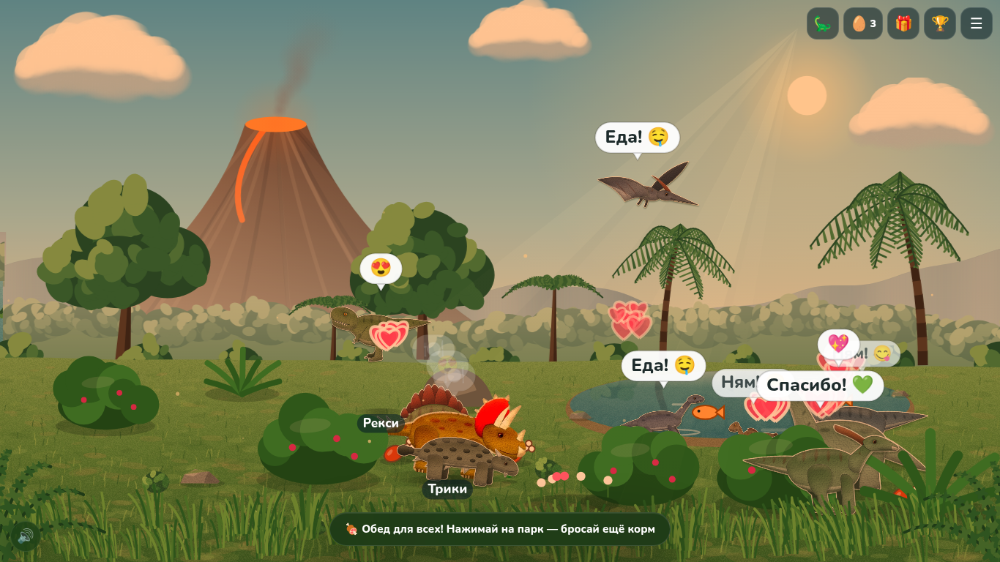

# 🦖 Динопарк

**Раскрась динозавра на бумаге — и он оживёт.** Ребёнок раскрашивает распечатанный лист,
фотографирует его телефоном, и динозавр выбегает в живой парк: гуляет, ест, играет, засыпает
и путешествует по пяти локациям. Парк можно вывести на телевизор, а телефон станет пультом.

© 2026 Юрий Власенко. Все права защищены. Копирование, изменение и использование кода
без письменного разрешения запрещено (см. [`LICENSE`](LICENSE)).



## Что умеет

| | |
|---|---|
| 🏠 **Лендинг** | `index.html`: живая анимированная сцена, кнопка «Войти в парк», 3 шага, возможности, раскраски, ТВ. Удобно на телефоне. |
| 🗂️ **Мои парки** | `parks.html`: несколько парков, у каждого код (10 символов) и пароль (6 цифр). Открыть парк с другого устройства по коду и паролю. |
| 🎓 **Знакомство и демо** | В пустом парке показывается короткое знакомство. `park.html?demo=1` — демо-парк с 11 динозаврами, ничего не сохраняется. |
| 📷 **Динозавр с фото** | Камера или файл. 4 угловые метки с кодом вида внутри каждой (вид узнаётся даже по одной метке), несколько порогов, выравнивание бумаги и баланса белого, автоуровни, удаление печатного контура (цвет «дотекает» за линию), ползунки «Яркие цвета» и «Яркость». Если метки не нашлись — «Найдено N из 4 меток» и подсказка. Без меток — вырезание по контрасту. |
| 📱 **QR для телефона** | На экране «Сфотографировать» есть QR-код: телефон сразу открывает этот парк с камерой (пароль из адреса тут же убирается). |
| 🍖🎾💤 **Потребности** | Голод, Игра, Сон убывают со временем. Значки краснеют и пульсируют, когда значение низкое. Динозавр сам засыпает, если устал, ищет еду и играет. Нажмите на динозавра — карточка со шкалами и кнопками **Покормить / Поиграть / Уложить спать**. Сохраняется в парке и синхронизируется с ТВ. |
| 🍗 **Кормление** | «Покормить всех» — корм для всех, на ТВ объявление «Обед!». «🤫 Тайно покормить своих» — корм с блёстками появляется только рядом с вашими динозаврами (⭐ владелец — это устройство), без объявления на ТВ. |
| 🦕 **Динозавры** | 9 видов (тираннозавр, трицератопс, стегозавр, брахиозавр, птеродактиль, плезиозавр, паразауролоф, анкилозавр, велоцираптор): шарнирные «марионетки» с текстурой кожи, светотенью, контровым светом и глазами со зрачками. |
| 🗣️ **Голоса** | У каждого вида 2 варианта голоса (собраны из ваших записей: низкие — тираннозавру, высокие — раптору и птеродактилю). Звучат при нажатии, во время еды и при пробуждении; у каждого динозавра свой тембр. Включаются и выключаются в меню. |
| 🌋 **5 локаций** | Джунгли с вулканом, Озеро-лагуна, Пустыня-каньон, Ледниковая долина, Ночной лес. Переключатель в меню, «Путешествие» (взять всех с собой), отправка одного динозавра из карточки. Свой фон — отдельно, привязывается к выбранной локации. |
| 🌿 **Природа** | Процедурная живописная графика: параллакс, дымка, листва, качающаяся трава, отражения в воде, лучи света, время суток (день/вечер/ночь или по часам). Никаких чужих картинок. |
| 📺 **ТВ** | `tv.html`: вход по 5-значному коду или QR (код живёт 5 минут). ТВ никогда не открывает меню, только показывает парк и объявления. |
| 🛠️ **Админ** | Переименовать парк, показать код и пароль, сменить пароль, время суток, значки желаний, удалить парк (на сервере 30 дней хранится в корзине). |
| 🖨️ **Раскраски** | `coloring.html`: 9 листов A4 с метками и кодом вида, печать одного или всех. |
| 🎵 **Музыка** | Фоновая мелодия «Treasure Hunter» (TAD, CC0) и голоса птиц; кнопка 🔊/🔇. Музыка из «Парка юрского периода» не используется. |

## Новое в v3

- **Яйца** за заботу (кормить, играть, укладывать): 🥚 обычное 76% · 💎 редкое 19% · 🔮 очень редкое 4,5% · 🌟 легендарное 0,5%.
  Не чаще раза в 3 часа на динозавра; яйцо на земле через 20 минут само попадает в корзину. Яйца — валюта:
  обмен 6 обычных → 1 редкое, 5 редких → 1 очень редкое; 8 шапок (надевает австралопитек); 🌟 золотой динозавр за 5 очень редких
  (или 2 легендарных).
- **Звери и племя**: землеройка, белка, бобр, ёжик, барсук приходят сами; австралопитеки Ук, Ага и Тоба медленно учатся
  (ягоды → палка → камень → огонь → … → вождь, от часа до двух недель). Окно «🧔 Племя».
- **Нужды** — в панели «🦕 Мои динозавры» (а не над головами); голод и скука проходят сами примерно через 30 минут.
  Кнопки «Покормить / Поиграть / Уложить / Разбудить» для всех и для каждого.
- **Большой мир**: перетаскивание, щипок, колесо, крупный план; иногда динозавр уходит погулять и возвращается.
  Игры вдвоём, прятки за кустами и камнями (не нашли — выйдет сам), подарки от любимых динозавров, 25 достижений.
- **Пригласить друга** (у друга сразу редкое яйцо; награда пригласившему — только через сервер) и «Поделиться» (обычное яйцо раз в день).
- **Поддержка**: ссылка на Telegram из `DP_CONFIG.SUPPORT_TELEGRAM_URL` в `js/config.js`, иначе форма (сохраняется на устройстве, а при сервере уходит в `DATA_DIR/feedback.jsonl`).
- **Подарочные коды** `DP1.…` подписаны ECDSA P-256: открытый ключ в `js/config.js`, закрытый — только у администратора.
  Скрытая страница `admin.html` хранит ключ в localStorage браузера администратора (можно импортировать/экспортировать),
  создаёт код или ссылку `park.html?gift=…`. Код одноразовый (на сервере — по номеру), может быть привязан к парку и иметь срок.
  С сервером: `ADMIN_TOKEN=… npm start` включает `POST /api/admin/gift` (Bearer-токен) — подарок сразу в «🎁 Подарки» парка.
- Всё медленно и по часам; оффлайн засчитывается не больше 12 часов (наполовину). Для проверки: `park.html?speed=60`.
- Новое для сервера: `ADMIN_TOKEN`, `MAX_FEEDBACK_PER_HOUR` (5), `MAX_REF_PER_HOUR` (10).

## Запуск

**Без сервера** (всё хранится в браузере, «ТВ» — в соседней вкладке):

```bash
python3 -m http.server 8000      # из корня репозитория → http://localhost:8000
```

**С сервером** (телефон + телевизор + хранение на сервере):

```bash
npm install
npm start                        # http://<IP-компьютера>:8080, ТВ: /tv.html
# или: docker build -t dinopark . && docker run -p 8080:8080 -v dinodata:/data dinopark
```

Настройки сервера через переменные окружения: `PORT` (8080), `DATA_DIR`, `MAX_PARKS`, `MAX_DINOS` (80),
`MAX_IMAGE_BYTES`, `MAX_BG_BYTES`, `MAX_PAYLOAD_BYTES`, `MAX_CREATE_PER_HOUR`, `TRUST_PROXY=1` (за прокси).
Проверка: `GET /health`.

**GitHub Pages** раздаёт сайт как есть (локальный режим). Для работы телефона и ТВ через интернет запустите
сервер на хостинге с WebSocket и укажите адрес в `js/config.js`:
`window.DP_CONFIG = { wsUrl: 'wss://ваш-сервер/ws' };`

## Безопасность сервера

- Пароль парка хранится как хеш **scrypt** с солью, проверка `timingSafeEqual`.
- Ограничение попыток с растущей блокировкой для пароля и ТВ-кода; лимит новых парков с IP.
- Лимиты: парков, динозавров в парке, размера картинок и сообщений.
- Каждый парк в своей папке, картинки — отдельными файлами; атомарная запись (временный файл + rename).
- Удалённые парки 30 дней лежат в корзине.
- Устойчивость к кривым адресам и неверному JSON; раздаются только разрешённые файлы сайта.

## Структура

```
index.html     лендинг            parks.html   мои парки        park.html   парк + меню
admin.html     подарочные коды (скрытая, noindex)
tv.html        экран ТВ           coloring.html раскраски       viewer.html → tv.html
css/           стили              assets/      музыка, голоса, иконка
js/            util, store, sync, needs, voices, dinos, template, photo, backgrounds, scene,
               ui, park, parks, landing, tv, music, config, life (яйца, племя, подарки), creatures, admin, vendor/qrcode.js
server/        server.js (HTTP + WebSocket), test/security.test.js, test/v3.test.js
tests/         e2e.js, scan-stress.js, mobile.js (iPhone), screens/ (скриншоты)
tools/         make-voices.sh (сборка голосов из записей)
legacy/        предыдущая версия сайта (Three.js-демо, сканер, панель, исходные записи голосов)
```

## Тесты

```bash
npm install && npm test                                   # безопасность сервера (node --test)
cd tests && npm install                                   # playwright-core, нужен установленный Chrome
BASE=http://localhost:8000 node e2e.js                    # статический режим
BASE=http://localhost:8080 SERVER=1 node e2e.js           # с сервером (синхронизация между «устройствами»)
BASE=http://localhost:8000 node scan-stress.js            # стресс-тест распознавания (99 фото)
BASE=http://localhost:8000 node mobile.js                 # iPhone: лендинг → новый парк → динозавры (WebKit, если установлен: npx playwright install webkit)
```

## Советы по фото

- Печатайте в масштабе 100%: метки должны остаться на листе.
- Снимайте сверху при ровном свете; достаточно 3 меток из 4, но лучше все 4.
- Раскрашивайте ярко; ползунки «Яркие цвета» и «Яркость» помогут, если фото тусклое.

## Сторонние компоненты

- `js/vendor/qrcode.js` — генератор QR-кодов, © Kazuhiko Arase, лицензия в `js/vendor/LICENSE-qrcode-generator.txt`.
- `assets/audio/treasure-hunter.mp3` — TAD, CC0 1.0 (`assets/audio/LICENSE.txt`).
- Голоса динозавров собраны из записей владельца проекта (`legacy/demos/audio/`, см. `tools/make-voices.sh`).
